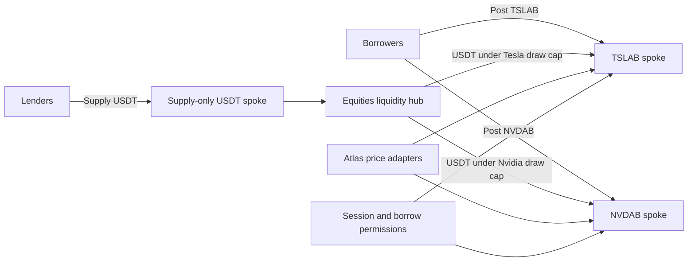

# Architecture v2

**Blue Finance · 2026-11-27 · Design for a local prototype**

Blue Finance will use an Aave V4-style hub and spoke architecture for lending against tokenized US stocks. One USDT hub funds multiple stock markets on BNB Chain. Each stock gets its own spoke, which enforces its borrowing limits and handles its collateral, debt, and liquidations. The first prototype pairs TSLAB and NVDAB with a single USDT hub on a local BNB mainnet fork.

[Architecture v1](architecture-v1.md) describes the current Morpho Blue implementation. V2 is the direction for new development. The preferred production route is a Blue-operated Aave V4 deployment on BNB Chain, subject to a production license or waiver.

## 1. What we’re taking from Aave and Zona

- **Aave V4** shows how a hub can supply shared liquidity to authorized spokes under separate draw caps. Its Base Equities Hub uses USDC and Coinbase stock tokens, with a lending spoke that accepts multiple equities in one position. Blue’s first prototype uses one stock per spoke so each stock’s halt, cap, and recovery rules can be enforced independently. [Aave V4 contracts](https://github.com/aave/aave-v4/blob/main/docs/overview.md) · [Base Equities Hub](https://governance.aave.com/t/arfc-deploy-aave-v4-on-base/25427)
- **Zona Lend** deployed an Aave-based pool on Robinhood Chain, chain ID 4663. Its public source pins Aave V3 Origin 3.6.0. Blockscout verifies the deployed pool proxy, while the exact version comes from the source package. Zona’s useful precedent is a separate restriction on new borrowing. It can set an asset’s borrowing power to zero while leaving its liquidation threshold intact, and borrow permission expires if monitoring goes silent. Liquidation can continue during a borrowing closure while prices are valid and reserves permit it. [Zona source package](https://github.com/zona-hk/zona-public/blob/main/contracts/package.json) · [Pool proxy](https://robinhoodchain.blockscout.com/api/v2/addresses/0xc07d049859642b299E75bc85Aa4752653F8380c1) · [Zona market hours](https://docs.zona.finance/lending/oracles)

## 2. How borrowing works



1. A lender supplies USDT through the supply-only spoke and receives a proportional claim on the USDT pool. Withdrawals depend on available USDT.
2. A borrower deposits a stock token into its spoke, such as TSLAB into the Tesla spoke. Positions use one stock as collateral and USDT as debt.
3. The spoke checks the borrower’s signed eligibility, the stock’s borrow permission and price, the position’s debt after interest, and the applicable caps. If the checks pass, the spoke draws USDT from the hub and delivers it to the borrower. The position records the debt in that spoke.
4. The borrower repays USDT plus accrued interest through the same spoke and can withdraw collateral when the resulting position is allowed. A liquidator can repay eligible debt and seize collateral through that spoke.

Tesla and Nvidia borrowers compete for the same available USDT. Their collateral and debt are tracked separately, but lenders in a shared hub are exposed to losses from both spokes. Draw caps limit exposure. The production design needs explicit rules for recognizing a spoke deficit, applying any loss buffer, and reflecting uncovered losses in supplier claims.

## 3. On-chain stock controls

**Enforcement.** Every entry point that borrows or increases risk against an existing position must pass the spoke’s checks, including calls through delegated managers and any batch or gateway. A router can bundle deposit and borrow for the app. The spoke is where the checks are enforced. Reuse the v1 EIP-712 eligibility pattern with expiry, replay protection, and a domain bound to the chain and verifying contract. Define attestation scope for the account and spoke before enabling delegated flows.

**Borrow limit.** Use accrued debt for the position and per-regime checks. The hub enforces available liquidity and a hard draw cap per registered spoke. Blue enforces the stock’s per-regime debt ceiling and the borrower’s position limit. A lower cap stops new draws above the cap and leaves existing debt outstanding. Repayment reduces the amount counted toward the caps.

```text
borrow limit = collateral value × base borrow LTV × (1 − regime discount)
liquidation health = collateral value × liquidation threshold ÷ accrued debt value
```

Both formulas use collateral and debt values in the same quote currency. The regime discount applies once, to borrowing capacity. For illustration, $1,000 of collateral with a 50% base borrow LTV supports $500 in regular hours and $425 with a 15% weekend discount. With a 62.5% liquidation threshold and $500 of debt, liquidation health stays at 1.25 through the calendar change if prices and debt stay fixed. These values illustrate the design. The actual limits need calibration against reopening gaps, executable liquidation prices, and market depth.

| Condition | Borrow and withdraw with debt | Repay and liquidation |
|---|---|---|
| `OPEN`, `EXTENDED`, `CLOSED`, `WEEKEND` | Apply each regime’s discount and cap to new borrowing. Withdrawals must leave the position within the applicable borrowing and health limits. New risk requires a fresh price and current monitoring. | Repay without a collateral price. Liquidate when the position is unhealthy and the valuation and token transfers are usable. |
| `HALTED`, `CORP_ACTION`, expired monitoring, or a price too stale for new risk | Block these actions for the affected spoke. | Repay without a collateral price. Liquidation depends on whether the retained valuation is still usable and the token can transfer. |
| Collateral valuation unavailable for liquidation | Block these actions for the affected spoke. | Repay remains available. Liquidation waits for a usable valuation. |

The borrow gate also leaves collateral top-ups and debt-free withdrawals available when the stock token can transfer. A token issuer pause or compliance restriction can independently block collateral transfers, including seizures. A scheduled market close or expired monitoring heartbeat alone does not stop liquidation while the price remains usable.

**Monitoring and recovery.** Reuse the US Eastern calendar and the existing Binance, Nasdaq, and multiplier signals. Add an expiring borrow permission per spoke so an expired registry override or a silent reporter cannot reopen borrowing. A fresh report cannot clear a guardian hold. After a halt or corporate action, reopening requires healthy sources, a fresh price, and a multiplier and price that agree. Resume after a configured recovery window. Route a genuine price gap outside the continuity band for explicit review so the system can accept a new reference. The guardian can stop new risk or lower caps. Restoring guardian-held borrowing or raising caps belongs to governance. Keeper keys can report status and renew or clear routine restrictions only within their assigned permissions.

## 4. Price and liquidation handling

- **Adapt Atlas pricing.** Keep the v1 `latestRoundData()` validation and multiplier continuity logic as a starting point. Normalize to the lending engine’s required quote currency and decimals. Verify the feed address, code access, and whether it quotes each raw token or each displayed unit for every selected bStock. A feed already priced per raw token must not be multiplied again. If the engine uses separate USD prices for stock and debt, configure a verified USDT/USD source and test a depeg. [Current Atlas findings](protocol-old/README.md#atlas-feed-findings-bsc-mainnet-probed-2026-11-26-1359-1405-utc-public-rpc)
- **Track freshness for borrowing and liquidation separately.** Freeze acceptance of suspect observations during an unresolved split, bad tick, or feed outage. For liquidation, retain the last validated valuation only while within a configured age limit and compatible with the effective multiplier and issuer state. Treat an expired or incompatible reference as unavailable. Test both a multiplier-first and a feed-first split so an apparent price change cannot be mistaken for a real loss. Set the fallback age, continuity limits, and recovery rules before using real collateral.
- **Use the lending engine’s liquidation entry point.** Replace the Morpho callback, health calculation, and event indexing in the liquidation bot with the new engine’s calls and accounting. For an upstream V4 implementation, size liquidation using its target health factor, variable bonus, and accrued debt. Start the local prototype with a pre-funded liquidator and test seized collateral delivery, partial liquidation, and debt left after collateral is exhausted. [Current callback](protocol-old/src/LiquidatorCallback.sol) · [Aave V4 liquidation logic](https://github.com/aave/aave-v4/blob/main/src/spoke/libraries/LiquidationLogic.sol)

## 5. Repo changes

| Area | V2 work |
|---|---|
| Contracts | Add the hub and stock spokes, or integrate the chosen V4 core. Move `BlueRouter` eligibility, cap, and regime checks into the spoke’s enforcement path. Reuse `RegimeRegistry` and extract the Atlas adapter logic from the Morpho-specific `BlueOracle` representation. Replace Morpho market IDs, authorizations, and borrow-share accounting with the new engine’s position and reserve interfaces. |
| Deploy scripts and fixtures | Deploy one USDT hub, register one supply-only spoke and two stock lending spokes, configure sources and caps, fund through the supply spoke, assign roles, and verify the resulting permissions. Use deployer-minted mock bStocks with configurable multipliers for deterministic tests. Use verified live Atlas feeds and separate real-token compatibility tests on the BNB fork. |
| Keepers and app | Keep session and issuer monitoring. Add borrow-permission renewal and recovery status. Show stock-specific borrowing power, the reason a spoke is closed, shared available USDT, and the borrower’s accrued debt and liquidation health. Add repay and withdraw flows. |
| Advisory risk controller | Update the model and proposal schema for the hub, spoke, reserve, and separate borrowing and liquidation parameters. Keep recommendations subject to review. The existing Morpho `setMargin` and `setCaps` proposals apply to v1. |

## 6. Deployment layout and license

In the self-hosted deployment, Blue operates both the hub and the spokes. Together they form the lending core. Blue registers its own spokes and sources the USDT liquidity. Connecting to an official Aave hub would require governance approval for the spoke, assets, and limits. A canonical Aave V4 hub on BNB Chain is unverified. [Aave V4 architecture](https://github.com/aave/aave-v4/blob/main/docs/overview.md) · [Aave deployment report](https://governance.aave.com/t/aave-labs-180-day-report/26342)

| Contract group | First deployment |
|---|---|
| Shared USDT liquidity | **One Blue Equities Hub** with a funded USDT reserve and **one supply-only USDT spoke** for lenders to deposit and withdraw. The hub sets the draw limit for each registered stock spoke. Aave’s Base Equities Hub uses a dedicated supply-only spoke for its USDC reserve. |
| Stock lending | **Two stock lending spokes**, TSLAB and NVDAB. Aim to deploy both from one stock-spoke implementation with different collateral, price sources, and risk configuration. Each enforces eligibility, borrow permission, and risk limits and handles positions and liquidations. |
| Pricing, permissions, and admin | Configure the Aave oracle, interest-rate strategy, access manager, hub and spoke configurators, and any proxy administration required by the chosen release. Reuse Blue’s `RegimeRegistry` and add the per-stock Atlas adapters and USDT price source. Blue’s expiring borrow permissions, eligibility checks, and guardian controls may be implemented in the spoke or in shared contracts that the spoke must call. A router may bundle transactions for the app. The keeper and liquidation bot run off-chain. |

The first deployment has **one hub and three spoke instances**, plus pricing, permissions, and admin contracts. The final address count depends on the pinned Aave release, proxies, and which helpers can be shared. [Base Equities Hub](https://governance.aave.com/t/arfc-deploy-aave-v4-on-base/25427) · [Aave V4 permissions book](https://github.com/aave-dao/aave-permissions-book/blob/main/out/ETHEREUM-V4.md)

**License.** Aave V4 uses Aave Labs’ Business Source License. It grants test-environment use subject to its terms, including restrictions involving contributors to competing products. Production use of the code or a derivative requires a waiver or commercial license granted by Aave Labs at the direction of Aave governance. The code converts to MIT five years after Aave V4’s Ethereum mainnet deployment or on an earlier date set by governance. A public demo that uses real, economically meaningful USDT counts as production even with mock collateral and low caps. Confirm the terms for the exact release and files before using them. If a production grant is unavailable, an independently implemented hub and spoke design is the production alternative and needs its own accounting and security review. [Aave V4 license](https://github.com/aave/aave-v4/blob/main/LICENSE) · [Aave code licensing](https://aave.com/docs/resources/code-licensing)

## 7. Prototype and launch decisions

Use a local BNB mainnet fork to verify the design. The harness’s mock collateral and low caps are useful for demonstration. When reporting results, distinguish mock-token behavior, live-feed reads, and actual bStock transfer compatibility.

| Local check | Expected result |
|---|---|
| Supply USDT once, then borrow against TSLAB and NVDAB | Each borrow uses its own spoke and reduces the same hub’s available USDT. The hub rejects an unregistered caller, a draw above the spoke cap, or a draw larger than available cash. |
| Flip to `WEEKEND` | Borrowing capacity drops. Existing liquidation health stays the same when prices and debt are held fixed. |
| Halt Tesla or let its borrow permission expire | Tesla-backed new borrowing and withdrawals with debt fail, including direct spoke calls. Tesla repayment remains available and Nvidia-backed borrowing continues with fresh permission and available liquidity. |
| Try a delegated borrow with missing, expired, or replayed eligibility | The spoke rejects the borrow. A fresh monitoring report also leaves a guardian hold in place. |
| Run a split with inconsistent feed and multiplier updates | The affected spoke holds new risk until both observations are consistent and recovery conditions pass. Liquidation cannot use a valuation invalidated by the split. |
| Apply a real price gap, then liquidate | Health reflects the lower validated price. The liquidator repays and receives collateral when transfers work. Check deficit and supplier accounting if recoverable collateral falls short. |
| Exercise full repay and withdrawal | A borrower can repay without a collateral price and withdraw debt-free collateral when the issuer permits transfers. |

Before a deployment decision, resolve the production route, verify the per-token Atlas mappings and live halt sources, define deficit treatment, test issuer permissions for custody and liquidation, and review the contracts and risk parameters. Treat V2 as a separate deployment. Any migration of live Morpho positions would need a borrower-approved flow that repays the original debt, withdraws collateral, and opens a new position. Mainnet broadcast requires explicit owner approval.
