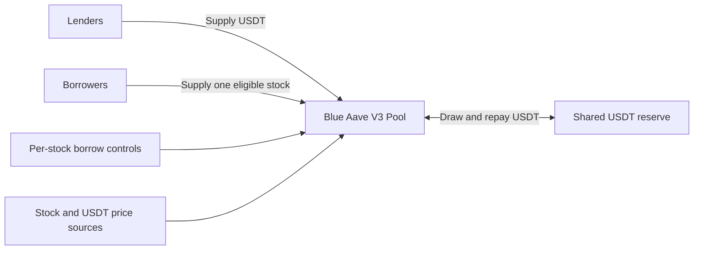

# Architecture v3

**Blue Finance · 2026-11-27 · Aave V3 design for BNB Chain**

Blue’s BNB Chain design uses **one Aave V3 pool with one shared USDT reserve**. Lenders supply USDT once. Borrowers use one eligible stock token as collateral per account. The BNB Chain configuration includes TSLAB, NVDAB, QQQB, SPCXB, and GOOGLB. Every borrower draws from the same reserve. The pool enforces stock-specific rules modeled on Zona Lend, so a Tesla halt can stop new Tesla-backed loans while other eligible borrowing and Tesla repayment continue.

V3 is the current implementation and supersedes the [V4 hub and spoke proposal](architecture-v2.md). The [Morpho architecture](architecture-v1.md) documents the earlier implementation.

Build the Aave V3 contracts in [`protocol/`](protocol/README.md). The Morpho implementation and its demo contracts live in [`protocol-old/`](protocol-old/README.md). The two directories build independently.

## 1. How borrowing works

1. **Lend.** A lender supplies USDT through the pool and receives interest-bearing bluUSDT. Borrowers’ debt is recorded in bluDebtUSDT. Withdrawals depend on how much USDT is available.
2. **Post collateral.** A borrower supplies one of the supported stock tokens and enables it as collateral. The stock reserves are collateral only. USDT is the sole borrowable asset and does not count as collateral in the first deployment.
3. **Borrow.** The pool checks the borrower’s active stock, eligibility, borrow permission, debt after interest, and the applicable limits. If approved, it draws from the shared USDT reserve and records variable-rate debt.
4. **Repay or liquidate.** The borrower repays USDT plus interest and can withdraw the stock when the position permits it. Liquidators use the pool’s liquidation entry point when Aave reports an eligible position and collateral can transfer.

A single USDT reserve lets borrowers draw available cash without a lender or allocator moving it between stock markets. USDT suppliers are exposed to losses across all listed collateral. A per-stock debt ceiling limits new concentration. If a liquidation falls short, the shared reserve still bears the resulting exposure. Pin and test how the selected V3 release records a deficit, who may cover it, and how a shortfall affects supplier withdrawals. [Aave V3 market structure](https://aave.com/blog/unlimited-lending-market-structures) · [Aave V3 Pool and tokens](https://aave.com/docs/aave-v3/smart-contracts)

## 2. Stock-specific borrowing controls

Zona Lend uses Aave V3 Origin 3.6.0 on Robinhood Chain. Its borrow permission expires when monitoring goes silent, and its asset gate can reduce new borrowing power to zero while leaving the liquidation threshold intact. Blue follows that separation between permission to add risk and valuation of existing positions. Blue uses the BNB bStock calendar, issuer signals, and Atlas feeds. [Zona source package](https://github.com/zona-hk/zona-public/blob/main/contracts/package.json) · [Zona market hours](https://docs.zona.finance/lending/oracles)

**Enforce at the pool.** The borrow path must inspect the account that will owe the debt, including for delegated borrowing. Every path that can open debt must pass the same checks, including any flash loan mode that opens debt. Disable unsupported debt-opening modes for the prototype. With debt outstanding, the account’s designated stock cannot change. Enforce this through collateral enable and disable operations, automatic collateral activation, withdrawals, and bluToken transfer hooks. Repayment and liquidation must reduce the debt attributed to that stock, and the stock assignment can clear when debt reaches zero. A UI or router can bundle transactions while the pool enforces the policy. [V3.6.0 Pool entry points](https://github.com/aave-dao/aave-v3-origin/blob/v3.6.0/src/contracts/protocol/pool/Pool.sol) · [V3.6.0 borrow logic](https://github.com/aave-dao/aave-v3-origin/blob/v3.6.0/src/contracts/protocol/libraries/logic/BorrowLogic.sol)

**Enforce two levels of caps.** Use the V3 reserve-wide USDT supply and borrow caps. Add an on-chain debt ceiling per stock, with limits for new borrowing that depend on the stock’s market status. Evaluate outstanding stock debt including interest plus the requested loan against that ceiling. For the prototype, validate accounting that groups scaled USDT variable debt by stock and converts it using the reserve’s current debt index. Reconcile that grouping against the pool after borrowing, all repayment paths, liquidation, and any deficit write-off. A cap reduction prevents new draws above the cap while existing debt remains outstanding.

**Keep the borrow limit separate from liquidation.** The pool applies Blue’s market-status discount to borrowing power and retains Aave’s configured liquidation threshold. Require the resulting position to meet both Blue’s limit and Aave’s standard validation. For example, $1,000 in collateral at a 50% base borrow LTV supports $500 in regular hours and $425 with a 15% weekend borrowing discount. If a borrower already owes $500 and has a 62.5% liquidation threshold, their health factor stays at 1.25 through the calendar change when prices and debt are held fixed. These figures are illustrative. Calibrate the launch limits against gap risk and executable liquidation depth. [Aave V3 health factor](https://aave.com/docs/aave-v3/overview)

| Stock status | Borrow and withdraw with debt | Repay and liquidate |
|---|---|---|
| `OPEN`, `EXTENDED`, `CLOSED`, `WEEKEND` with fresh prices and permission | Check stock-specific caps and borrowing power. A withdrawal with debt must leave enough collateral under the current limits. | Repay through the pool. Liquidation uses Aave’s health factor and applicable prices. |
| Expired monitoring, recovery window, or a price too old for new borrowing | Block new borrowing for that stock. Following Zona, withdrawals and bluToken transfers with debt continue while the valuation price is valid and the account stays within the current limit. | Keep repayment available. Liquidation can continue if its price and transfer checks pass. |
| `HALTED`, `CORP_ACTION`, or guardian hold | Block both for accounts using the affected stock. Other eligible stocks can continue drawing USDT. | Keep repayment available. Liquidation can continue if its price and transfer checks pass. |
| Valuation unusable for liquidation | Block new risk for that stock. | Keep repayment available. Liquidation waits for a usable valuation. |

The borrow restriction leaves debt-free withdrawal and collateral top-ups available when pool limits and issuer transfer rules allow them. A stock issuer can independently block collateral movement, including liquidation transfers. Avoid using a blanket pool pause for a routine stock halt so unaffected borrowers retain access and affected borrowers can reduce debt.

**Permission and recovery.** Use `MarketCalendar`, carried over from the Morpho `RegimeRegistry`, for market hours, holidays, early closes, and overrides. The keeper renews borrow permission per stock using verified stock and issuer signals. Expired, stale, or unknown evidence cannot reopen a restriction. Reopening after a split or halt requires a fresh price consistent with the active multiplier and a configurable window of healthy evidence. Route genuine gaps outside the continuity band for review before new borrowing resumes. Liquidation uses the gapped price meanwhile. The guardian can halt new risk or lower caps. Governance can release a guardian hold or raise caps. Reuse the EIP-712 eligibility approach with expiry, replay protection, and a chain- and pool-bound domain. The first implementation should bind eligibility to the borrowing account and market before enabling delegation.

## 3. Pricing and liquidations

- **Price stock and USDT in a common base currency.** Verify the Atlas feed mapping, read access, decimals, and whether the feed quotes a raw token or displayed unit for each bStock. Read `latestRoundData()` inside the validating adapter and expose the interface required by the selected V3 oracle. A raw-token price already incorporating the multiplier needs no second adjustment. Configure a USDT/USD source and test a depeg. Review the pool oracle’s fallback configuration so a rejected price cannot fall through to an unvalidated source. [Current Atlas findings](protocol-old/README.md#atlas-feed-findings-bsc-mainnet-probed-2026-11-26-1359-1405-utc-public-rpc) · [V3.6.0 oracle](https://github.com/aave-dao/aave-v3-origin/blob/v3.6.0/src/contracts/misc/AaveOracle.sol)
- **Use separate standards for valuation and new borrowing.** Following Zona, health and liquidation read the live round when it is within the liquidation age limit, inside a fixed absolute price band, consistent with the multiplier of the last accepted price, and the stock is not in `CORP_ACTION`. Large moves are accepted for valuation, so a genuine gap reaches liquidators without waiting for review. New borrowing additionally needs a fresh round accepted within the continuity band and a live stock permission. A gap outside the band stops new loans until governance accepts a new reference. Once the valuation is unusable, liquidation stops for the affected stock until it recovers. A schedule change alone leaves the valuation intact. [Zona prices and market hours](https://docs.zona.finance/lending/oracles) · [Zona liquidation behavior](https://docs.zona.finance/lending/health-factor)
- **Atlas stock pricing.** The BNB Chain configuration uses Atlas for each stock and Chainlink for USDT. The price source supports an optional second feed for new borrowing. The APRO setup lives in a separate module and requires APRO to allowlist Blue’s contracts. [APRO BNB feeds](https://docs.apro.com/en/data-push/price-feed-contract) · [Venus APRO review](https://community.venus.io/t/bnb-chain-apro-onboarding-core-pool-oracle-updates/5901)
- **Flag corporate actions before they take effect.** The keeper sets `CORP_ACTION` ahead of an announced split. A feed-first split without that flag is indistinguishable from a crash and can trigger liquidations. A multiplier change stops valuation until governance accepts a round that reflects it. Test feed-first and multiplier-first corporate actions, plus a genuine reopening gap.
- **Use Aave’s liquidation accounting.** Replace the Morpho callback with Aave’s `liquidationCall` and read accrued debt and health from the pool. Start with a pre-funded liquidator and validate repayment sizing, collateral delivery, close factors, bonuses, and deficit handling against the pinned release. Exercise issuer permissions on actual bStock transfers separately from test-token scenarios. [V3.6.0 Pool entry points](https://github.com/aave-dao/aave-v3-origin/blob/v3.6.0/src/contracts/protocol/pool/Pool.sol)

## 4. Contracts and repo changes

| Area | V3 deployment or repo work |
|---|---|
| Aave lending core | One Blue-operated Pool with six reserves. Deploy the Pool addresses provider, configurator, access manager, oracle, interest-rate strategy, and receipt and debt token infrastructure required by the pinned release. Supply receipts are bluTokens (for example bluUSDT, bluTSLAB) and debt tokens are bluDebtTokens (bluDebtUSDT); they are Aave aTokens and variable debt tokens under Blue names. Fund the USDT reserve through the Pool. |
| Blue contracts | Use `MarketCalendar`. Add stock borrow permissions, eligibility and debt-ceiling checks in the pool’s enforcement path, and Atlas price adapters. Keep a router optional for transaction bundling. |
| Scripts and fixtures | Deploy a dedicated pool on a local BNB mainnet fork. Deploy the real bStocks, Atlas feeds, and Chainlink USDT/USD. Use test tokens only inside tests for deterministic cases, and verify actual feed reads and real-token custody and transfers in fork tests. Keep exposures low for the demonstration. |
| Keepers and frontend | Reuse market hours, issuer signals, and multiplier monitoring. Add stock permission renewal and show available USDT, accrued debt, health, stock borrowing capacity, and why a stock is blocked. Use the Pool for supply, borrow, repay, and withdraw. |
| Advisory risk controller | Update recommendations for a Pool, stock reserve, stock debt ceiling, and separate borrowing and liquidation parameters. Keep recommendations subject to review. |

## 5. Release and license

**Use Aave V3 Origin 3.6.0 as the reference for the first prototype.** It matches Zona’s source baseline and gives us a concrete implementation to study. V3.7 removes the native PriceOracleSentinel and Isolation Mode debt ceilings. Blue’s stock-specific policy must be enforced independently of those features. Pick the production tag after reviewing license eligibility, fixes, audit coverage, and the required changes to the pool. [V3.6.0 license](https://github.com/aave-dao/aave-v3-origin/blob/v3.6.0/LICENSE) · [Aave V3 features](https://aave.com/docs/aave-v3/overview) · [Aave V3 contract changes](https://aave.com/docs/aave-v3/smart-contracts)

- **V3 Origin 3.6.0 and 3.7.0.** Their BUSL 1.1 terms include a conditional production grant, with conditions around migration of Aave users or funds, prior competing forks, and harm to Aave. The licenses specify an MIT change date of March 6, 2027 or an earlier designated date. Review the exact tag and Blue’s eligibility for any production use before that change. [V3.6.0 license](https://github.com/aave-dao/aave-v3-origin/blob/v3.6.0/LICENSE) · [V3.7.0 license](https://github.com/aave-dao/aave-v3-origin/blob/v3.7.0/LICENSE)
- **Original V3 Core.** Its license converted to MIT by January 27, 2023. It is an older baseline and would need a review of fixes and capabilities added in later releases. [Original V3 Core license](https://github.com/aave/aave-v3-core/blob/master/LICENSE.md)

## 6. Leveraged borrowing in Simplified Mode

**Step 2. Choose an action.** Add a **One-click leveraged borrow** card alongside **Borrow**. Use **Up to N× leverage** as the subtitle once a product-wide cap is configured. Check the connected wallet’s atomic batching capability for BNB Chain only when the user selects the leverage card. If the wallet or network changes, check again before offering one-click execution. Treat unsupported, unavailable, or rejected batching as a reason to offer the guided flow in Step 4. Ordinary Borrow proceeds without a batching check. [EIP-5792 wallet capabilities](https://eips.ethereum.org/EIPS/eip-5792)

**Step 4. Preview and execute.** After the user chooses a stock, show the leverage available for that stock and session, estimated swap output, resulting debt, health factor, and estimated liquidation price. Apply the pool’s borrowing rules, the product cap, available USDT, and the swap quote. Opening or increasing a leveraged long borrows USDT, swaps it for more of the same stock, and supplies that stock as collateral. Preview reducing or closing the position too. During a halt, withdrawals with debt may be blocked and repayment may require wallet USDT.

| Path | Simulator behavior |
|---|---|
| Wallet supports atomic batching | Simulate the calls as one action from the account that owns the position. Apply the position change only if every step succeeds. |
| Batching is unavailable or declined | Guide the user through borrow, swap, and redeposit. Update the simulated balances after each step. If the swap fails after borrowing, show the outstanding debt and the option to repay with the borrowed USDT. |

For live one-click execution, require atomic batching and recheck the account, chain, stock permission, quote expiry, and slippage bound before submitting. Every borrow still passes the pool’s stock controls. A batch of ordinary calls can use the same lending interfaces when each borrow is within the limit at that point in the sequence. A helper contract or flash-loan path can be evaluated separately for targets that the ordinary calls cannot reach in one pass. [Zona guided leverage](https://docs.zona.finance/trade/positions)

## 7. Local acceptance checks

| Scenario | Expected result |
|---|---|
| Fund the USDT reserve once and borrow against all five stocks | All borrowers draw from the same cash balance. Verify reserve caps, separate stock ceilings, interest accrual, and lender withdrawal against available cash. |
| Halt Tesla or let its permission expire | Direct pool calls and delegated debt-opening calls fail for Tesla. Nvidia-backed borrowing continues with valid prices, permission, and liquidity. Tesla borrowers can repay. |
| Try to bypass stock attribution | Test enabling a second stock, switching collateral while in debt, transferring bluTokens, and any other route that can open or move debt. The stock assignment and ceilings remain accurate. |
| Switch to `WEEKEND` or receive a stale report | Borrowing capacity falls or new borrowing stops according to policy. Existing liquidation health stays the same when prices and debt are held fixed. A fresh report leaves a guardian hold in place. |
| Exercise both split update orders and a genuine price gap | Block borrowing on inconsistent prices. Prevent liquidation using a split-invalid valuation. A validated price drop updates health and allows liquidation when transfers work. |
| Repay, liquidate, and resolve a shortfall | Verify stock debt accounting across partial repay, full repay and withdrawal, liquidation, and the selected release’s deficit path. Check that repayment works even when a collateral price is unavailable. |
| Simulate both leverage paths | Ordinary Borrow makes no capability request. The leverage card checks BNB Chain support. An atomic failure leaves the simulated position intact. An unsupported wallet gets the guided path, where completed steps remain visible after a later failure. |

Before launch, confirm the production license and release, live Atlas and halt sources, issuer transfer permissions, and shared-reserve deficit handling. Calibrate parameters and review the pool modifications before using real assets. Any live Morpho position would need a borrower-approved migration that repays the original debt, withdraws collateral, and opens a new position. Mainnet broadcast requires explicit owner approval.
